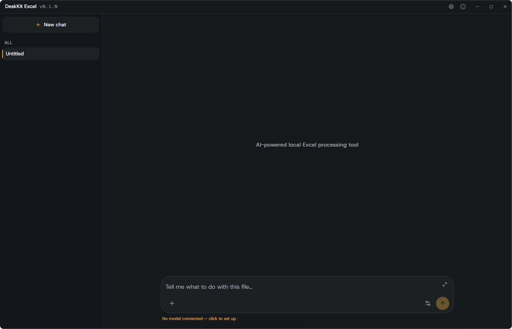

# DeskKit Excel

An AI-driven batch processor for Excel files, running entirely on your own machine.

Describe what you want in one sentence, point it at a folder, and it works through
the files locally. No account, and the files themselves never leave the machine.

```
You:   merge the 200 department reports into one sheet, summarised by department
It:    reads 200 xlsx files → aligns headers → merges → groups → writes summary.xlsx
       all local, no upload, no account
```



## What it is for

The job it does is narrow: take many spreadsheet files that are messy or
inconsistently shaped, and turn them into one clean table. Merging, cleaning,
de-duplicating, splitting, extracting columns, comparing two versions.

Common cases:

- **Bank statement reconciliation** — bank exports are often GBK-encoded CSV with
  inconsistent date and amount formats. Merge a month of statements, normalise the
  columns, match amounts against your ledger.
- **Broker and trading statements** — merge monthly trade confirmations from a broker,
  total by ticker, check the numbers against your own records.
- **Month-end report merging** — 200 department files, headers that don't match.
  Align the headers, merge, summarise by department.
- **E-commerce order exports** — combine daily order dumps from several stores into
  one sheet, group by SKU, drop duplicate order IDs.
- **Payroll and HR sheets** — merge per-department payroll files; verify headcount
  and totals line up.
- **Audit and sampling** — pull a sample of rows, or diff two versions of a workbook
  to see exactly what changed.
- **Survey and research data** — merge exported batches, remove duplicate respondents,
  reshape columns.

What it does **not** do: charts, statistics, forecasting, portfolio analysis. It gets
your data into one clean table; the analysis is up to you.

A cloud AI can't do this well: it can't read 3,000 files on your disk, and most
companies won't upload their financial workbooks to somebody else's server.

## Status

Early. No version number worth quoting yet, and it is honest about that:

- **Excel only.** That is the whole scope. One tool, one job.
- **Keep it in a folder you can write to.** The updater stages the new build inside
  the app's own directory (an atomic rename on the same volume is the only safe way
  to swap a running executable). Installed under `C:\Program Files` or any read-only
  location, the in-app update will fail — move the folder somewhere under your user
  profile, or update by hand. Two builds worth of free disk space are needed while it
  runs.
- **Windows 10 and later.** The app refuses to start on older Windows. macOS builds
  exist and run, but are not polished.
- **Unsigned binaries.** SmartScreen and Gatekeeper will warn about an unknown
  developer. That is what unsigned means, not a sign of a problem.
- **AI output can be wrong.** The app lists pending changes and asks for
  confirmation before writing, but verify results yourself — especially amounts,
  IDs and dates.
- **No support promise.** Issues and suggestions are welcome; no response time is promised.

## Using AI

All batch operations work without AI. With a model connected you can also just
describe the job in words.

| Option | Notes |
|---|---|
| Your own key | Any OpenAI-compatible endpoint (DeepSeek, OpenAI, OpenRouter, …) |
| Local model | Auto-detects Ollama / LM Studio on this machine — keeps everything offline |

Keys are stored on the local machine only (`0600`), never uploaded.

## What leaves this machine

Being precise about this, because "local" and "no upload" can be read two ways:

- **Your files stay local.** Reading, cleaning, merging, writing — all of it happens
  on this machine. The app makes no request to any server by default.
- **With a local model** (Ollama / LM Studio on your own machine) nothing leaves at all.
- **With a cloud model** you configured (DeepSeek, OpenAI, OpenRouter …), the model
  provider receives your chat messages **and the results the tools return** — which can
  include table excerpts, column values and query output. That is inherent to using a
  hosted model: it has to see the data to answer. The app shows which provider is in
  use under the input box, and says so explicitly when it is not a local one.
- **The update check** is the only other outbound request, and it is a version check.

If the data must not leave the machine under any circumstances, use a local model —
that keeps everything on disk.

## Build

Requirements: Go 1.26+, Node 22+, and the Wails v3 CLI. The session database uses
SQLCipher, so `CGO_ENABLED=1` is required.

```bash
wails3 dev                  # hot reload
wails3 build                # build
go test ./internal/...      # tests
./scripts/build-app.sh              # macOS .app bundle
```

On Windows with MSYS2, `gcc` from `ucrt64` must be on `PATH`, and the binary should be
linked with `-H windowsgui`, otherwise a console window opens alongside the app.

## Layout

```
main.go               entry: embeds config and frontend, calls boot.Run
internal/
  boot/               wiring and startup: config → local service → AI → single instance → window
  ai/                 model access: protocol, streaming, tool-call loop, error normalisation
  config/             config parsing (app.yaml / windows.yaml)
  server/             embedded local HTTP service
  window/             config-driven multi-window
  update/             self update
  tools/              capability packages (excel, fs)
config/app.yaml       app config (AI, service, update, i18n)
```

## Stack

Wails v3.1.0 · Go 1.26 · Vue 3 · TypeScript · Vite · SQLCipher (session storage).
File operations live in a separate Go module, `fsx`.

## License

MIT — see [LICENSE](./LICENSE).
